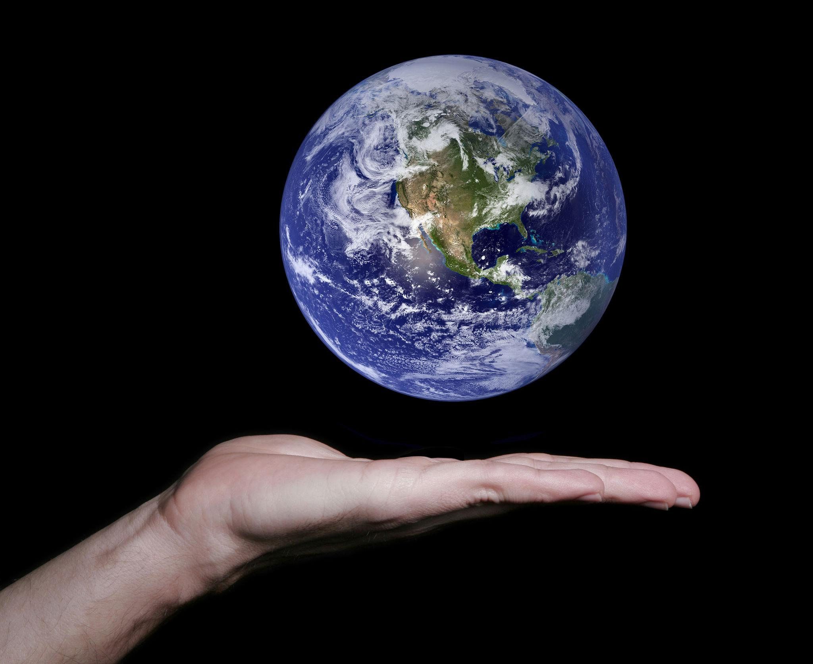

Create a minimal, visually rich, real-time hand-tracking experience where the user appears to hold a tiny planet in the palm of their hand.

## Core Experience

Use the webcam to track the user's hand in real time. Place a small, detailed 3D planet above the center of the palm, creating the illusion that the user is carrying a miniature world.

- **Move:** The planet smoothly follows the palm as the user moves their hand around.
- **Tilt:** Tilting the hand influences the planet's orientation and orbital motion.
- **Rotate:** When the hand becomes still, the planet creates subtle planetary rotation, giving the world a sense of continuity and life.
- **Disappear:** When the hand leaves the camera view, the planet gently fades away instead of abruptly vanishing.
- **Return:** When the hand reappears, the planet materializes with a subtle glow and a small orbital particle effect.

## 3D Asset Requirements

3D assets is under [Toy Cartoon Planets](public/models/toy_cartoon_planets.glb) . That glb files include total 10 globe so we need to show only one globe at the time.

## Visual Direction

The experience should feel like a miniature celestial object floating above a real human palm, see ref at 

- A beautifully detailed planet with gentle self-rotation.
- A thin atmospheric rim or subtle planetary glow.
- A few tiny particles orbiting the planet.
- Soft lighting that gives the planet depth and volume.
- A subtle shadow or light spill beneath the planet to help anchor it visually to the palm.
- A clean, unobtrusive background that keeps attention on the hand and planet.

Avoid excessive stars, complicated space backgrounds, oversized UI, and distracting effects. The real hand should remain the primary visual anchor.

## Hand Tracking and Motion

Use webcam-based hand tracking and hand landmarks to estimate the palm's position and orientation.

- Map the palm position into the 3D scene using a stable coordinate mapping.
- Small Smooth movement using interpolation or a damped spring to prevent jitter.
- Position the planet slightly above the palm, accounting for hand orientation and perspective.
- Use palm rotation to influence the planet's tilt without making it spin uncontrollably.
- Add subtle motion lag so the planet feels responsive but not rigidly attached.
- Handle temporary tracking loss gracefully.

The planet should remain visually attached to the palm even when the user moves, tilts, or rotates their hand.

## Technical Constraints

- Build on the existing web-based 3D and hand-tracking architecture.
- Use Three.js or the project's existing React Three Fiber setup.
- Load a real GLB/glTF asset rather than generating a static planet illustration.
- Keep tracking, rendering, and animation synchronized in real time.
- Optimize for smooth performance on ordinary laptops and webcams.
- Keep the experience self-contained, with no dependency on external model-hosting services at runtime if the asset can be bundled locally.

## Success Criteria

Within the first few seconds, users should understand that they can hold a planet in their palm.

Moving the hand should feel natural. The planet should feel alive, but the interaction should remain calm and effortless.

The final result should be minimal in interaction, rich in visual detail, and polished enough to feel like a premium interactive camera effect.

**Design principle: One hand. One planet. An entire little world that follows you.**
